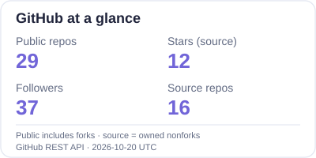
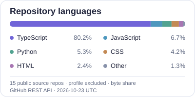

<picture>
  <source media="(prefers-color-scheme: dark)" srcset="./assets/hero-dark.svg">
  
</picture>

  <a href="https://x.com/MIA03ther">X / Twitter</a> ·
  <a href="https://mia03ther.github.io/">Portfolio</a> ·
  <a href="mailto:mia03ther@gmail.com">Email</a>

你好，我是 **MIA_Ether**，广外本科在读，目前在广州。
用 AI 辅助开发，边做边学，探索 **AI Agents、Web3 与数据应用**。
喜欢把想法做成能运行的小产品，也记录构建过程。

## Selected Projects

- **[Aegis Agent](https://github.com/0xChainAegis/aegis-agent)** — 正在和团队构建：受预算、权限与审批约束的 Agent 钱包补款 Demo，备战 ETH Shenzhen 2026。
- **[YutuHub](https://github.com/mia03ther/YutuHub)** — 校园知识与服务平台实验，整理学习资源、经验与协作机会。
- **[Arbitera](https://github.com/Ali-Adel-Nour/Arbitera)** — 开源协作贡献：AI Judge、后端流程与 MCP 信誉查询。

## Tech Stack

  <picture>
    <source media="(prefers-color-scheme: dark)" srcset="https://skillicons.dev/icons?i=python,ts,js,react,nodejs,prisma,git,docker&amp;theme=dark&amp;perline=8">
    
  </picture>

项目中使用和学习的工具 · Exploring: AI Agents / MCP / Solidity / Chainlink / SQL

## GitHub Stats

<picture>
  <source media="(prefers-color-scheme: dark) and (max-width: 480px)" srcset="./assets/generated/stats-mobile-dark.svg">
  <source media="(max-width: 480px)" srcset="./assets/generated/stats-mobile-light.svg">
  <source media="(prefers-color-scheme: dark)" srcset="./assets/generated/stats-dark.svg">
  
</picture>

## Metrics

<picture>
  <source media="(prefers-color-scheme: dark) and (max-width: 480px)" srcset="./assets/generated/metrics-mobile-dark.svg">
  <source media="(max-width: 480px)" srcset="./assets/generated/metrics-mobile-light.svg">
  <source media="(prefers-color-scheme: dark)" srcset="./assets/generated/metrics-dark.svg">
  
</picture>

每日从 GitHub 公开 API 更新，卡片内标注统计日期与范围。语言占比反映仓库代码量，不代表熟练度。

---

Off-chain: 电子音乐 / 作曲 · 绘画 · 开源社区

